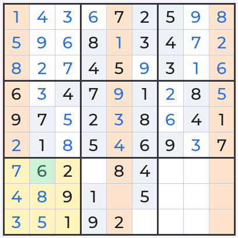

<!-- Written by tools/walkthrough.py 159-sudoku: edit the script, not this page. -->
# 159 Sudoku, step 35: the 6 in box 7

**Step 35 of 47** · [← Step 34](step-34.md) · [All steps](../159-sudoku.md#the-whole-puzzle-step-by-step) · [Step 36 →](step-36.md)

Box 7 needs a 6, and r7c2 is its last empty cell: **r7c2 = 6**.

**Step 35 of 47** · [← Step 34](step-34.md) · [All steps](../159-sudoku.md#the-whole-puzzle-step-by-step) · [Step 36 →](step-36.md)
