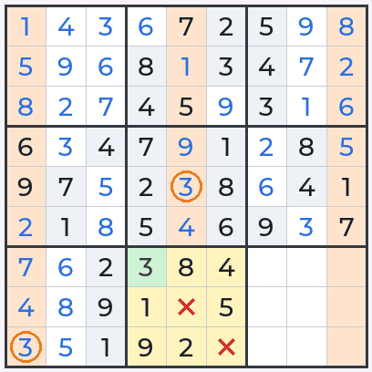

<!-- Written by tools/walkthrough.py 159-sudoku: edit the script, not this page. -->
# 159 Sudoku, step 36: the 3 in box 8

**Step 36 of 47** · [← Step 35](step-35.md) · [All steps](../159-sudoku.md#the-whole-puzzle-step-by-step) · [Step 37 →](step-37.md)

Box 8 needs a 3. r8c5: column 5 has one (r5c5). r9c6: row 9 has one (r9c1). Only **r7c4** is left: **r7c4 = 3**.

**Step 36 of 47** · [← Step 35](step-35.md) · [All steps](../159-sudoku.md#the-whole-puzzle-step-by-step) · [Step 37 →](step-37.md)
