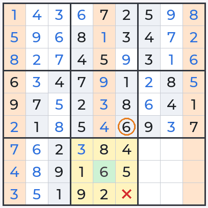

<!-- Written by tools/walkthrough.py 159-sudoku: edit the script, not this page. -->
# 159 Sudoku, step 37: the 6 in box 8

**Step 37 of 47** · [← Step 36](step-36.md) · [All steps](../159-sudoku.md#the-whole-puzzle-step-by-step) · [Step 38 →](step-38.md)

Box 8 needs a 6. r9c6: column 6 has one (r6c6). Only **r8c5** is left: **r8c5 = 6**.

**Step 37 of 47** · [← Step 36](step-36.md) · [All steps](../159-sudoku.md#the-whole-puzzle-step-by-step) · [Step 38 →](step-38.md)
