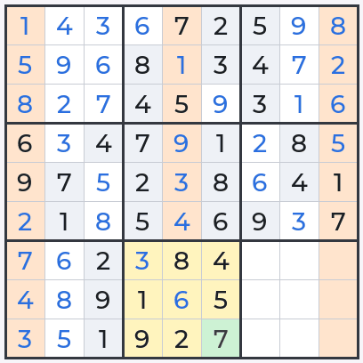

<!-- Written by tools/walkthrough.py 159-sudoku: edit the script, not this page. -->
# 159 Sudoku, step 38: the 7 in box 8

**Step 38 of 47** · [← Step 37](step-37.md) · [All steps](../159-sudoku.md#the-whole-puzzle-step-by-step) · [Step 39 →](step-39.md)

Box 8 needs a 7, and r9c6 is its last empty cell: **r9c6 = 7**.

**Step 38 of 47** · [← Step 37](step-37.md) · [All steps](../159-sudoku.md#the-whole-puzzle-step-by-step) · [Step 39 →](step-39.md)
