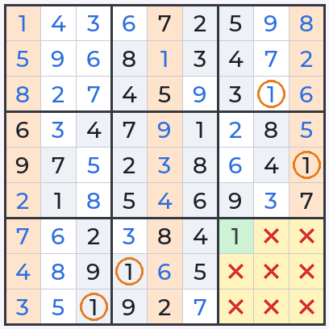

<!-- Written by tools/walkthrough.py 159-sudoku: edit the script, not this page. -->
# 159 Sudoku, step 39: the 1 in box 9

**Step 39 of 47** · [← Step 38](step-38.md) · [All steps](../159-sudoku.md#the-whole-puzzle-step-by-step) · [Step 40 →](step-40.md)

Box 9 needs a 1. r7c8: column 8 has one (r3c8). r7c9: column 9 has one (r5c9). r8c7, r8c8 and r8c9: row 8 has one (r8c4). r9c7, r9c8 and r9c9: row 9 has one (r9c3). Only **r7c7** is left: **r7c7 = 1**.

**Step 39 of 47** · [← Step 38](step-38.md) · [All steps](../159-sudoku.md#the-whole-puzzle-step-by-step) · [Step 40 →](step-40.md)
