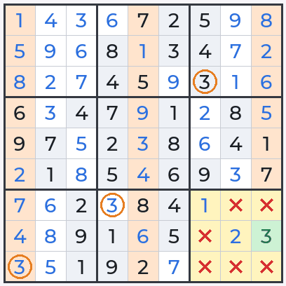

<!-- Written by tools/walkthrough.py 159-sudoku: edit the script, not this page. -->
# 159 Sudoku, step 41: the 3 in box 9

**Step 41 of 47** · [← Step 40](step-40.md) · [All steps](../159-sudoku.md#the-whole-puzzle-step-by-step) · [Step 42 →](step-42.md)

Box 9 needs a 3. r7c8 and r7c9: row 7 has one (r7c4). r8c7: column 7 has one (r3c7). r9c7, r9c8 and r9c9: row 9 has one (r9c1). Only **r8c9** is left: **r8c9 = 3**.

**Step 41 of 47** · [← Step 40](step-40.md) · [All steps](../159-sudoku.md#the-whole-puzzle-step-by-step) · [Step 42 →](step-42.md)
