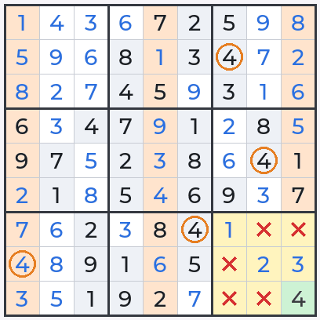

<!-- Written by tools/walkthrough.py 159-sudoku: edit the script, not this page. -->
# 159 Sudoku, step 42: the 4 in box 9

**Step 42 of 47** · [← Step 41](step-41.md) · [All steps](../159-sudoku.md#the-whole-puzzle-step-by-step) · [Step 43 →](step-43.md)

Box 9 needs a 4. r7c8 and r7c9: row 7 has one (r7c6). r8c7: row 8 has one (r8c1). r9c7: column 7 has one (r2c7). r9c8: column 8 has one (r5c8). Only **r9c9** is left: **r9c9 = 4**.

**Step 42 of 47** · [← Step 41](step-41.md) · [All steps](../159-sudoku.md#the-whole-puzzle-step-by-step) · [Step 43 →](step-43.md)
