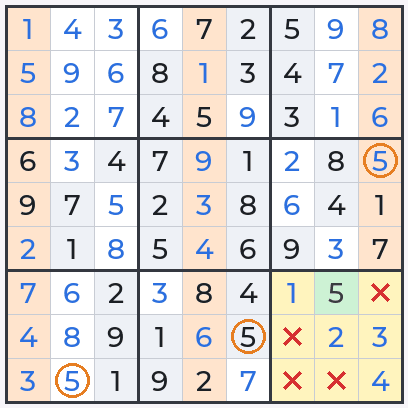

<!-- Written by tools/walkthrough.py 159-sudoku: edit the script, not this page. -->
# 159 Sudoku, step 43: the 5 in box 9

**Step 43 of 47** · [← Step 42](step-42.md) · [All steps](../159-sudoku.md#the-whole-puzzle-step-by-step) · [Step 44 →](step-44.md)

Box 9 needs a 5. r7c9: column 9 has one (r4c9). r8c7: row 8 has one (r8c6). r9c7 and r9c8: row 9 has one (r9c2). Only **r7c8** is left: **r7c8 = 5**.

**Step 43 of 47** · [← Step 42](step-42.md) · [All steps](../159-sudoku.md#the-whole-puzzle-step-by-step) · [Step 44 →](step-44.md)
