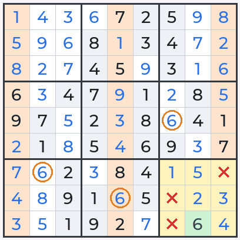

<!-- Written by tools/walkthrough.py 159-sudoku: edit the script, not this page. -->
# 159 Sudoku, step 44: the 6 in box 9

**Step 44 of 47** · [← Step 43](step-43.md) · [All steps](../159-sudoku.md#the-whole-puzzle-step-by-step) · [Step 45 →](step-45.md)

Box 9 needs a 6. r7c9: row 7 has one (r7c2). r8c7: row 8 has one (r8c5). r9c7: column 7 has one (r5c7). Only **r9c8** is left: **r9c8 = 6**.

**Step 44 of 47** · [← Step 43](step-43.md) · [All steps](../159-sudoku.md#the-whole-puzzle-step-by-step) · [Step 45 →](step-45.md)
