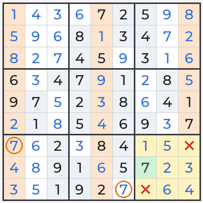

<!-- Written by tools/walkthrough.py 159-sudoku: edit the script, not this page. -->
# 159 Sudoku, step 45: the 7 in box 9

**Step 45 of 47** · [← Step 44](step-44.md) · [All steps](../159-sudoku.md#the-whole-puzzle-step-by-step) · [Step 46 →](step-46.md)

Box 9 needs a 7. r7c9: row 7 has one (r7c1). r9c7: row 9 has one (r9c6). Only **r8c7** is left: **r8c7 = 7**.

**Step 45 of 47** · [← Step 44](step-44.md) · [All steps](../159-sudoku.md#the-whole-puzzle-step-by-step) · [Step 46 →](step-46.md)
