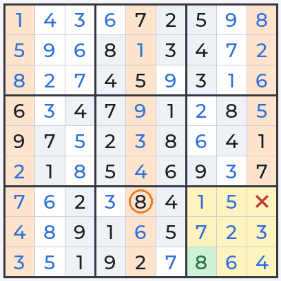

<!-- Written by tools/walkthrough.py 159-sudoku: edit the script, not this page. -->
# 159 Sudoku, step 46: the 8 in box 9

**Step 46 of 47** · [← Step 45](step-45.md) · [All steps](../159-sudoku.md#the-whole-puzzle-step-by-step) · [Step 47 →](step-47.md)

Box 9 needs an 8. r7c9: row 7 has one (r7c5). Only **r9c7** is left: **r9c7 = 8**.

**Step 46 of 47** · [← Step 45](step-45.md) · [All steps](../159-sudoku.md#the-whole-puzzle-step-by-step) · [Step 47 →](step-47.md)
