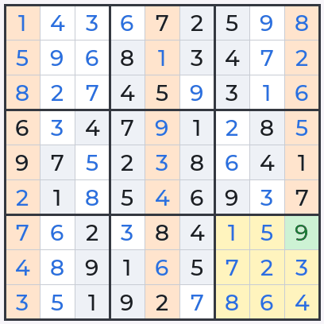

<!-- Written by tools/walkthrough.py 159-sudoku: edit the script, not this page. -->
# 159 Sudoku, step 47: the 9 in box 9

**Step 47 of 47** · [← Step 46](step-46.md) · [All steps](../159-sudoku.md#the-whole-puzzle-step-by-step) · [All steps](../159-sudoku.md#the-whole-puzzle-step-by-step)

Box 9 needs a 9, and r7c9 is its last empty cell: **r7c9 = 9**.

Solved.

**Step 47 of 47** · [← Step 46](step-46.md) · [All steps](../159-sudoku.md#the-whole-puzzle-step-by-step) · [All steps](../159-sudoku.md#the-whole-puzzle-step-by-step)
