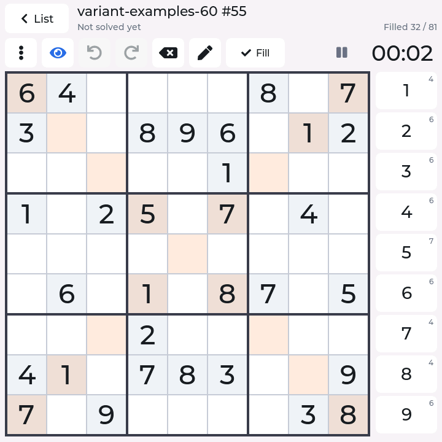

# Anti-Diagonal

[← All variants](README.md) · [Puzzles](../features-puzzles.md) · [How to play](../how-to-play.md)

## The rules

[Classic](classic.md) rules, and the **two long diagonals** (tinted) each hold **at most three different digits**. Unlike [X-Sudoku](x-sudoku.md), digits repeat along a diagonal: it crosses three boxes, so a digit can be on it up to three times, once per box. With 6, 5 and 8 on a diagonal, its other cells are all 6, 5 or 8.

## On the board

- Both long diagonals are tinted.
- A diagonal with a fourth different digit turns its digits red.
- The grader and hints: "A long diagonal holds at most three different digits, and the top-left diagonal has 5, 6, 8 already, so row 2, column 2 is one of them."
- **Puzzles → ⋮ → New puzzle → Grids → Anti-Diagonal.**

## How to solve it

- **Count the different digits on each diagonal:** at three, every empty cell on it takes one of those three.
- **Three boxes, three digits:** each box's three diagonal cells are different digits, so a diagonal's three digits show up once in each box it crosses: the full diagonal is those three digits three times.
- **The centre is on both diagonals,** so it's one of each diagonal's three digits.

## Worked example

**variant-examples #55**, Anti-Diagonal Easy (see [Classic](classic.md#worked-example-the-whole-puzzle) for how to import the examples; cells are written r*row*c*column*). The top-left diagonal has 6 (r1c1), 5 (r4c4), 8 (r6c6) and 8 (r9c9): three different digits already.

**Step 1: r2c2.** Row 2 has 3, 8, 9, 6, 1 and 2; column 2 has 4: that leaves 5 and 7. r2c2 is on the top-left diagonal, whose three digits are 5, 6 and 8. **r2c2 = 5**.

**Step 2: r3c3.** Box 1 has 6, 4, 3 and 5; row 3 has 1; column 3 has 2 and 9: that leaves 7 and 8. On the same diagonal, 7 would be a fourth digit. **r3c3 = 8**.

**Step 3: the 2 in row 8.** Row 8's empty cells are r8c3, r8c7 and r8c8. Column 3 has a 2 (r4c3), and r8c8 is on the top-left diagonal: only 5, 6 or 8. **r8c7 = 2**.

## The whole puzzle, step by step

<!-- walkthrough -->
<!-- Written by tools/walkthrough.py anti-diagonal: edit the script, not this part. -->

The whole puzzle, from the start to the last cell: 49 steps, each one a single (one place left for a digit, or one digit left for a cell), taken in the order a box's single comes first, so not quite the order of the worked example above. Each step has a page of its own, with **Previous** and **Next**: pick its number below. In each picture, the unit the step looks at is tinted yellow (for a cell with one digit left: its row, column and box), the new digit is on green, the digits that rule cells out have an **orange ring**, and the empty cells they rule out a **red cross**. Givens are on grey, digits from earlier steps in blue.

| [1](anti-diagonal/step-01.md) | [2](anti-diagonal/step-02.md) | [3](anti-diagonal/step-03.md) | [4](anti-diagonal/step-04.md) | [5](anti-diagonal/step-05.md) | [6](anti-diagonal/step-06.md) | [7](anti-diagonal/step-07.md) | [8](anti-diagonal/step-08.md) | [9](anti-diagonal/step-09.md) | [10](anti-diagonal/step-10.md) |
|:-:|:-:|:-:|:-:|:-:|:-:|:-:|:-:|:-:|:-:|
| [11](anti-diagonal/step-11.md) | [12](anti-diagonal/step-12.md) | [13](anti-diagonal/step-13.md) | [14](anti-diagonal/step-14.md) | [15](anti-diagonal/step-15.md) | [16](anti-diagonal/step-16.md) | [17](anti-diagonal/step-17.md) | [18](anti-diagonal/step-18.md) | [19](anti-diagonal/step-19.md) | [20](anti-diagonal/step-20.md) |
| [21](anti-diagonal/step-21.md) | [22](anti-diagonal/step-22.md) | [23](anti-diagonal/step-23.md) | [24](anti-diagonal/step-24.md) | [25](anti-diagonal/step-25.md) | [26](anti-diagonal/step-26.md) | [27](anti-diagonal/step-27.md) | [28](anti-diagonal/step-28.md) | [29](anti-diagonal/step-29.md) | [30](anti-diagonal/step-30.md) |
| [31](anti-diagonal/step-31.md) | [32](anti-diagonal/step-32.md) | [33](anti-diagonal/step-33.md) | [34](anti-diagonal/step-34.md) | [35](anti-diagonal/step-35.md) | [36](anti-diagonal/step-36.md) | [37](anti-diagonal/step-37.md) | [38](anti-diagonal/step-38.md) | [39](anti-diagonal/step-39.md) | [40](anti-diagonal/step-40.md) |
| [41](anti-diagonal/step-41.md) | [42](anti-diagonal/step-42.md) | [43](anti-diagonal/step-43.md) | [44](anti-diagonal/step-44.md) | [45](anti-diagonal/step-45.md) | [46](anti-diagonal/step-46.md) | [47](anti-diagonal/step-47.md) | [48](anti-diagonal/step-48.md) | [49](anti-diagonal/step-49.md) |  |

Solved.

<!-- /walkthrough -->
