# Anti-Diagonal

[← All variants](README.md) · [Puzzles](../features-puzzles.md) · [How to play](../how-to-play.md)

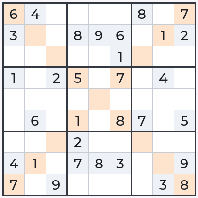

## The rules

[Classic](classic.md) rules, and the **two long diagonals** (tinted) each hold **at most three different digits**. Unlike [X-Sudoku](x-sudoku.md), digits repeat along a diagonal: it crosses three boxes, so a digit can be on it up to three times, once per box. With 6, 5 and 8 on a diagonal, its other cells are all 6, 5 or 8.

## On the board

- Both long diagonals are tinted.
- A diagonal with a fourth different digit turns its digits red.
- The grader and hints: "A long diagonal holds at most three different digits, and the top-left diagonal has 5, 6, 8 already, so row 2, column 2 is one of them."
- **Puzzles → ⋮ → New puzzle → Grids → Anti-Diagonal.**

## How to solve it

- **Count the different digits on each diagonal:** at three, every empty cell on it takes one of those three.
- **Three boxes, three digits:** each box's three diagonal cells are different digits, so a diagonal's three digits show up once in each box it crosses: the full diagonal is those three digits three times.
- **The centre is on both diagonals,** so it's one of each diagonal's three digits.

## Worked example

**variant-examples #55**, Anti-Diagonal Easy (see [Classic](classic.md#worked-example-the-whole-puzzle) for how to import the examples; cells are written r*row*c*column*). The top-left diagonal has 6 (r1c1), 5 (r4c4), 8 (r6c6) and 8 (r9c9): three different digits already.

**Step 1: r2c2.** Row 2 has 3, 8, 9, 6, 1 and 2; column 2 has 4: that leaves 5 and 7. r2c2 is on the top-left diagonal, whose three digits are 5, 6 and 8. **r2c2 = 5**.

**Step 2: r3c3.** Box 1 has 6, 4, 3 and 5; row 3 has 1; column 3 has 2 and 9: that leaves 7 and 8. On the same diagonal, 7 would be a fourth digit. **r3c3 = 8**.

**Step 3: the 2 in row 8.** Row 8's empty cells are r8c3, r8c7 and r8c8. Column 3 has a 2 (r4c3), and r8c8 is on the top-left diagonal: only 5, 6 or 8. **r8c7 = 2**.

## The whole puzzle, step by step

<!-- walkthrough -->
<!-- Written by tools/walkthrough.py anti-diagonal: edit the script, not this part. -->

The whole puzzle, from the start to the last cell: 49 steps, each one a single (one place left for a digit, or one digit left for a cell), taken in the order a box's single comes first, so not quite the order of the worked example above. In each picture, the unit the step looks at is tinted yellow (for a cell with one digit left: its row, column and box), the new digit is on green, the digits that rule cells out have an **orange ring**, and the empty cells they rule out a **red cross**. Givens are on grey, digits from earlier steps in blue.

#### Step 1: the 1 in box 1

Box 1 needs a 1. r2c2 and r2c3: row 2 has one (r2c8). r3c1, r3c2 and r3c3: row 3 has one (r3c6). Only **r1c3** is left: **r1c3 = 1**.

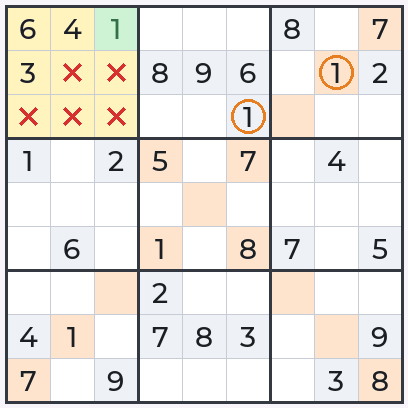

#### Step 2: the 7 in box 2

Box 2 needs a 7. r1c4, r1c5 and r1c6: row 1 has one (r1c9). r3c4: column 4 has one (r8c4). Only **r3c5** is left: **r3c5 = 7**.

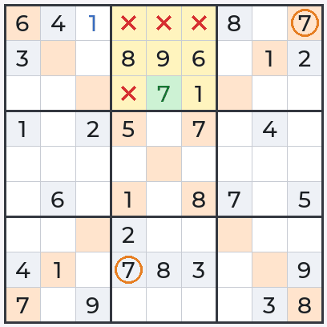

#### Step 3: the 7 in box 1

Box 1 needs a 7. r3c1, r3c2 and r3c3: row 3 has one (r3c5). r2c2: its long diagonal holds 5, 6 and 8 already, three different digits at most. Only **r2c3** is left: **r2c3 = 7**.

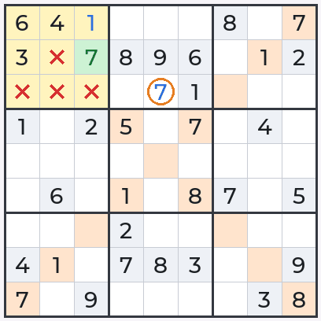

#### Step 4: the 4 in box 2

Box 2 needs a 4. r1c4, r1c5 and r1c6: row 1 has one (r1c2). Only **r3c4** is left: **r3c4 = 4**.

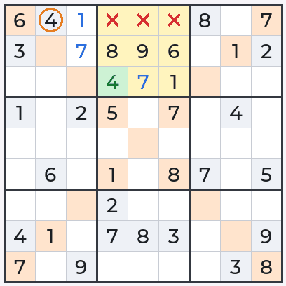

#### Step 5: the 4 in box 3

Box 3 needs a 4. r1c8: row 1 has one (r1c2). r3c7, r3c8 and r3c9: row 3 has one (r3c4). Only **r2c7** is left: **r2c7 = 4**.

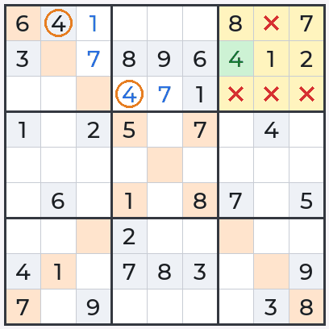

#### Step 6: the 7 in box 4

Box 4 needs a 7. r4c2: row 4 has one (r4c6). r5c1: column 1 has one (r9c1). r5c3: column 3 has one (r2c3). r6c1 and r6c3: row 6 has one (r6c7). Only **r5c2** is left: **r5c2 = 7**.

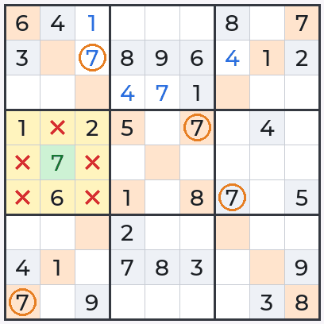

#### Step 7: the 8 in box 6

Box 6 needs an 8. r4c7 and r5c7: column 7 has one (r1c7). r4c9 and r5c9: column 9 has one (r9c9). r6c8: row 6 has one (r6c6). Only **r5c8** is left: **r5c8 = 8**.

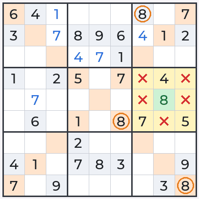

#### Step 8: the 8 in box 4

Box 4 needs an 8. r5c1 and r5c3: row 5 has one (r5c8). r6c1 and r6c3: row 6 has one (r6c6). Only **r4c2** is left: **r4c2 = 8**.

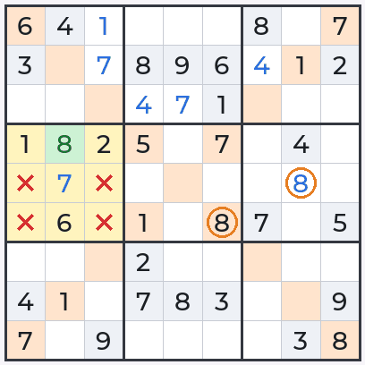

#### Step 9: the 2 in box 7

Box 7 needs a 2. r7c1, r7c2 and r7c3: row 7 has one (r7c4). r8c3: column 3 has one (r4c3). Only **r9c2** is left: **r9c2 = 2**.

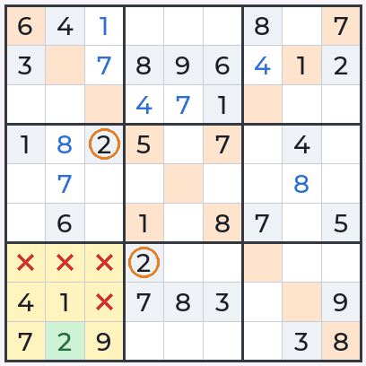

#### Step 10: the 2 in box 1

Box 1 needs a 2. r2c2: row 2 has one (r2c9). r3c2: column 2 has one (r9c2). r3c3: column 3 has one (r4c3). Only **r3c1** is left: **r3c1 = 2**.

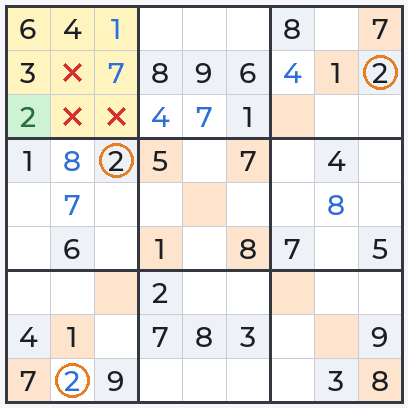

#### Step 11: the 8 in box 1

Box 1 needs an 8. r2c2: row 2 has one (r2c4). r3c2: column 2 has one (r4c2). Only **r3c3** is left: **r3c3 = 8**.

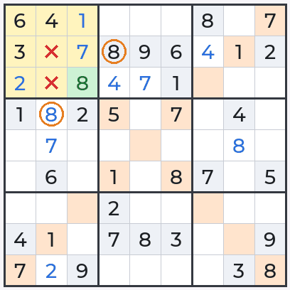

#### Step 12: the 9 in box 1

Box 1 needs a 9. r2c2: row 2 has one (r2c5). Only **r3c2** is left: **r3c2 = 9**.

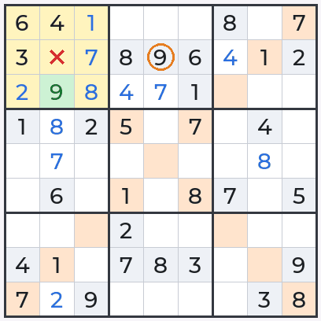

#### Step 13: the 5 in box 1

Box 1 needs a 5, and r2c2 is its last empty cell: **r2c2 = 5**.

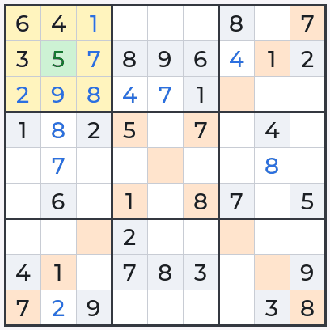

#### Step 14: the 9 in box 3

Box 3 needs a 9. r3c7, r3c8 and r3c9: row 3 has one (r3c2). Only **r1c8** is left: **r1c8 = 9**.

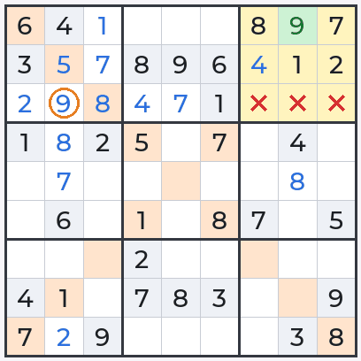

#### Step 15: the 8 in box 7

Box 7 needs an 8. r7c2: column 2 has one (r4c2). r7c3: column 3 has one (r3c3). r8c3: row 8 has one (r8c5). Only **r7c1** is left: **r7c1 = 8**.

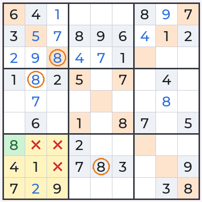

#### Step 16: the 9 in box 8

Box 8 needs a 9. r7c5: column 5 has one (r2c5). r9c4, r9c5 and r9c6: row 9 has one (r9c3). Only **r7c6** is left: **r7c6 = 9**.

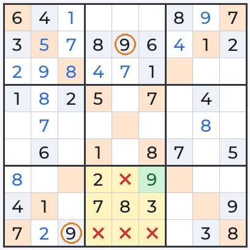

#### Step 17: the 9 in box 5

Box 5 needs a 9. r4c5, r5c5 and r6c5: column 5 has one (r2c5). r5c6: column 6 has one (r7c6). Only **r5c4** is left: **r5c4 = 9**.

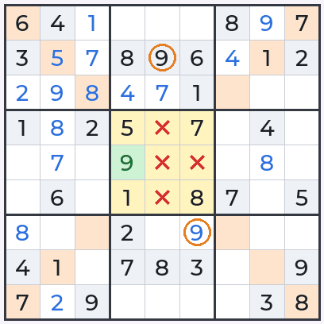

#### Step 18: the 9 in box 4

Box 4 needs a 9. r5c1 and r5c3: row 5 has one (r5c4). r6c3: column 3 has one (r9c3). Only **r6c1** is left: **r6c1 = 9**.

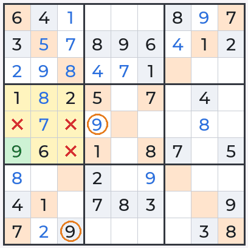

#### Step 19: the 9 in box 6

Box 6 needs a 9. r4c9: column 9 has one (r8c9). r5c7 and r5c9: row 5 has one (r5c4). r6c8: row 6 has one (r6c1). Only **r4c7** is left: **r4c7 = 9**.

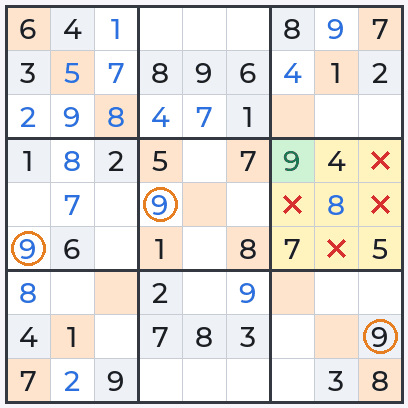

#### Step 20: the 2 in box 9

Box 9 needs a 2. r7c7, r7c8 and r7c9: row 7 has one (r7c4). r9c7: row 9 has one (r9c2). r8c8: its long diagonal holds 5, 6 and 8 already, three different digits at most. Only **r8c7** is left: **r8c7 = 2**.

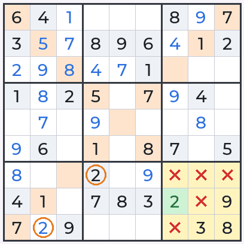

#### Step 21: the 2 in box 6

Box 6 needs a 2. r4c9: row 4 has one (r4c3). r5c7: column 7 has one (r8c7). r5c9: column 9 has one (r2c9). Only **r6c8** is left: **r6c8 = 2**.

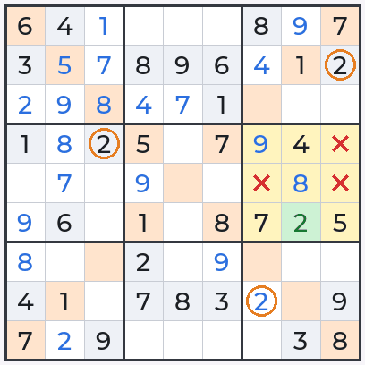

#### Step 22: the 2 in box 5

Box 5 needs a 2. r4c5: row 4 has one (r4c3). r6c5: row 6 has one (r6c8). r5c5: its long diagonal holds 5, 6 and 8 already, three different digits at most. Only **r5c6** is left: **r5c6 = 2**.

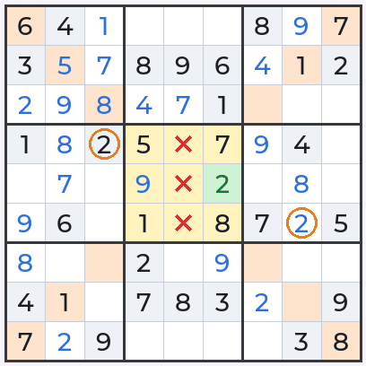

#### Step 23: the 2 in box 2

Box 2 needs a 2. r1c4: column 4 has one (r7c4). r1c6: column 6 has one (r5c6). Only **r1c5** is left: **r1c5 = 2**.

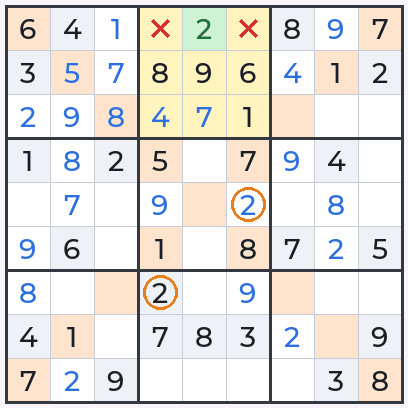

#### Step 24: the 3 in box 2

Box 2 needs a 3. r1c6: column 6 has one (r8c6). Only **r1c4** is left: **r1c4 = 3**.

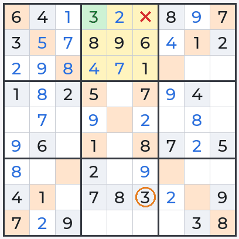

#### Step 25: the 5 in box 2

Box 2 needs a 5, and r1c6 is its last empty cell: **r1c6 = 5**.

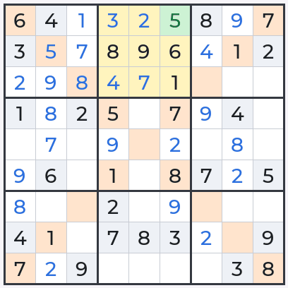

#### Step 26: the 4 in box 5

Box 5 needs a 4. r4c5: row 4 has one (r4c8). r5c5: its long diagonal holds 5, 6 and 8 already, three different digits at most. Only **r6c5** is left: **r6c5 = 4**.

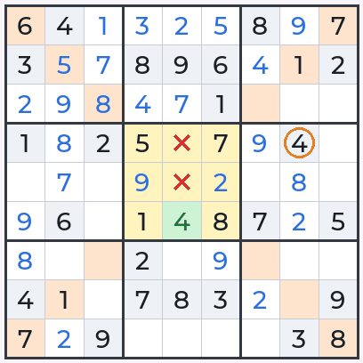

#### Step 27: the 4 in box 4

Box 4 needs a 4. r5c1: column 1 has one (r8c1). r6c3: row 6 has one (r6c5). Only **r5c3** is left: **r5c3 = 4**.

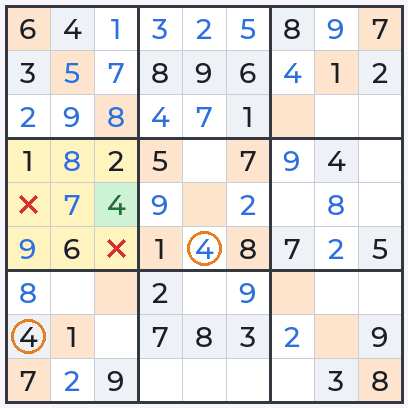

#### Step 28: the 3 in box 4

Box 4 needs a 3. r5c1: column 1 has one (r2c1). Only **r6c3** is left: **r6c3 = 3**.

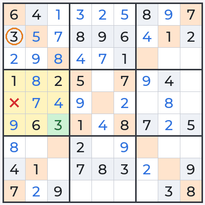

#### Step 29: the 5 in box 4

Box 4 needs a 5, and r5c1 is its last empty cell: **r5c1 = 5**.

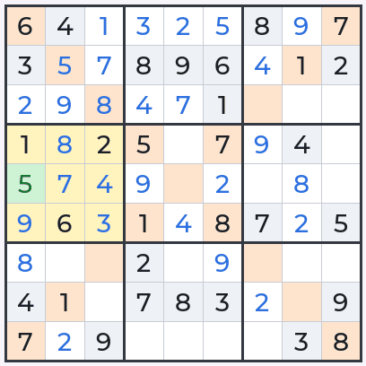

#### Step 30: the 3 in box 5

Box 5 needs a 3. r5c5: its long diagonal holds 5, 6 and 8 already, three different digits at most. Only **r4c5** is left: **r4c5 = 3**.

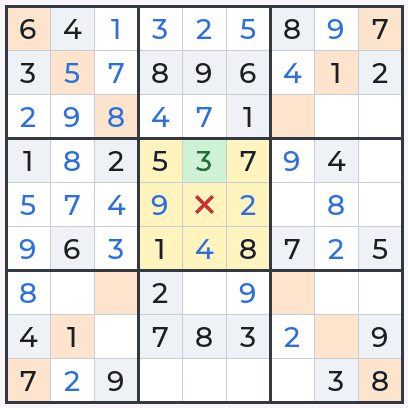

#### Step 31: the 6 in box 5

Box 5 needs a 6, and r5c5 is its last empty cell: **r5c5 = 6**.

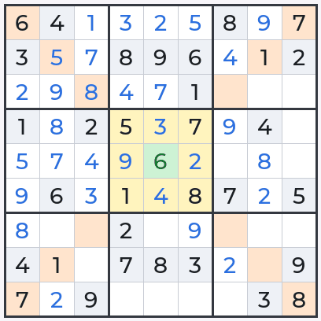

#### Step 32: the 3 in box 3

Box 3 needs a 3. r3c8: column 8 has one (r9c8). r3c7: its long diagonal holds 1, 6 and 7 already, three different digits at most. Only **r3c9** is left: **r3c9 = 3**.

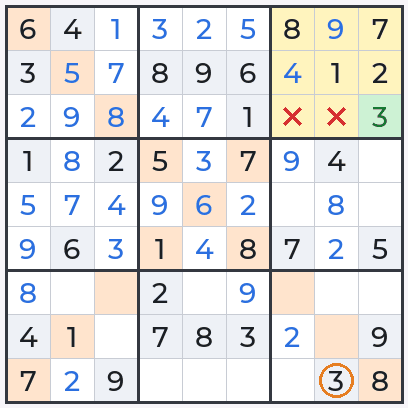

#### Step 33: the 5 in box 3

Box 3 needs a 5. r3c7: its long diagonal holds 1, 6 and 7 already, three different digits at most. Only **r3c8** is left: **r3c8 = 5**.

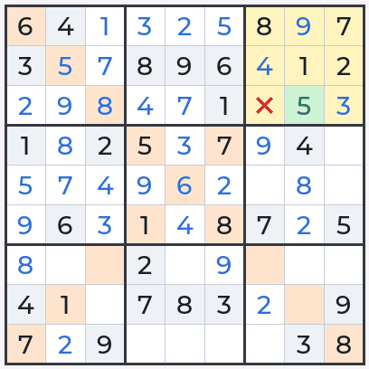

#### Step 34: the 6 in box 3

Box 3 needs a 6, and r3c7 is its last empty cell: **r3c7 = 6**.

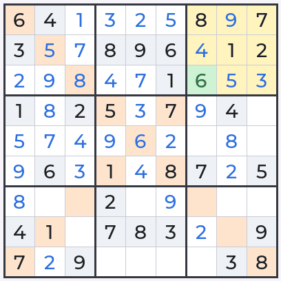

#### Step 35: the 3 in box 6

Box 6 needs a 3. r4c9: row 4 has one (r4c5). r5c9: column 9 has one (r3c9). Only **r5c7** is left: **r5c7 = 3**.

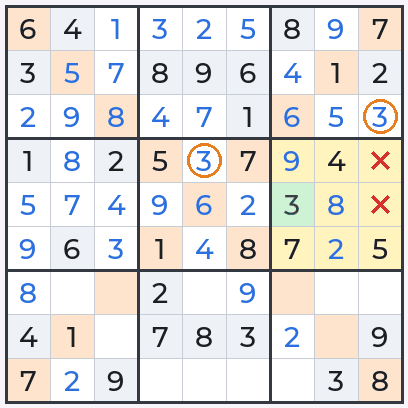

#### Step 36: the 1 in box 6

Box 6 needs a 1. r4c9: row 4 has one (r4c1). Only **r5c9** is left: **r5c9 = 1**.

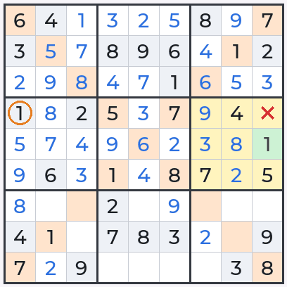

#### Step 37: the 6 in box 6

Box 6 needs a 6, and r4c9 is its last empty cell: **r4c9 = 6**.

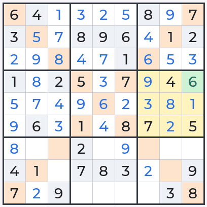

#### Step 38: the 3 in box 7

Box 7 needs a 3. r7c3: column 3 has one (r6c3). r8c3: row 8 has one (r8c6). Only **r7c2** is left: **r7c2 = 3**.

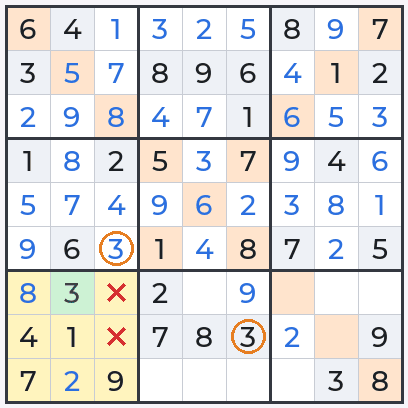

#### Step 39: the 5 in box 7

Box 7 needs a 5. r7c3: its long diagonal holds 1, 6 and 7 already, three different digits at most. Only **r8c3** is left: **r8c3 = 5**.

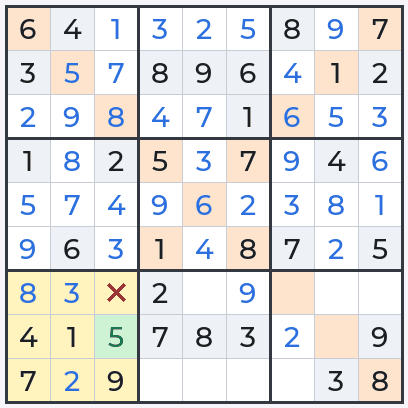

#### Step 40: the 6 in box 7

Box 7 needs a 6, and r7c3 is its last empty cell: **r7c3 = 6**.

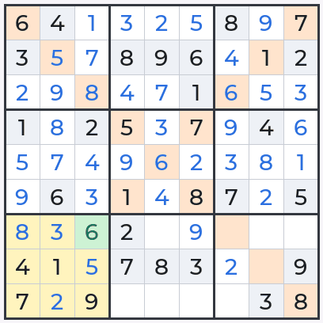

#### Step 41: the 4 in box 8

Box 8 needs a 4. r7c5 and r9c5: column 5 has one (r6c5). r9c4: column 4 has one (r3c4). Only **r9c6** is left: **r9c6 = 4**.

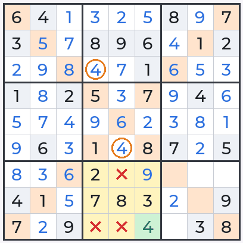

#### Step 42: the 6 in box 8

Box 8 needs a 6. r7c5: row 7 has one (r7c3). r9c5: column 5 has one (r5c5). Only **r9c4** is left: **r9c4 = 6**.

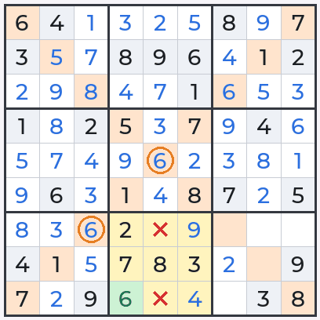

#### Step 43: the 1 in box 9

Box 9 needs a 1. r7c8: column 8 has one (r2c8). r7c9: column 9 has one (r5c9). r8c8: row 8 has one (r8c2). r7c7: its long diagonal holds 5, 6 and 8 already, three different digits at most. Only **r9c7** is left: **r9c7 = 1**.

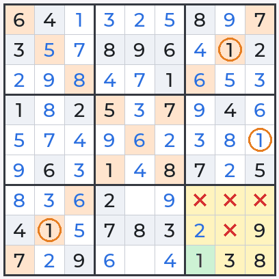

#### Step 44: the 1 in box 8

Box 8 needs a 1. r9c5: row 9 has one (r9c7). Only **r7c5** is left: **r7c5 = 1**.

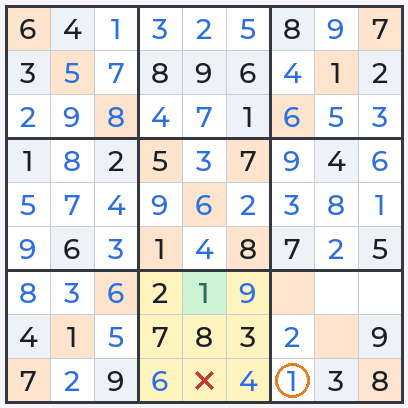

#### Step 45: the 5 in box 8

Box 8 needs a 5, and r9c5 is its last empty cell: **r9c5 = 5**.

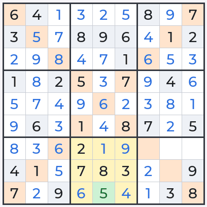

#### Step 46: the 4 in box 9

Box 9 needs a 4. r7c7: column 7 has one (r2c7). r7c8: column 8 has one (r4c8). r8c8: row 8 has one (r8c1). Only **r7c9** is left: **r7c9 = 4**.

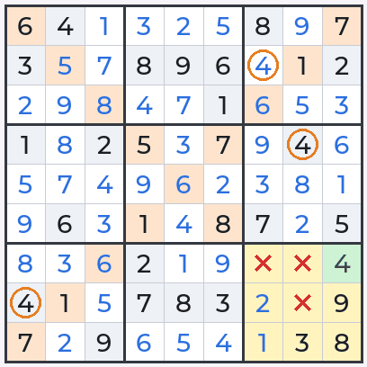

#### Step 47: the 5 in box 9

Box 9 needs a 5. r7c8: column 8 has one (r3c8). r8c8: row 8 has one (r8c3). Only **r7c7** is left: **r7c7 = 5**.

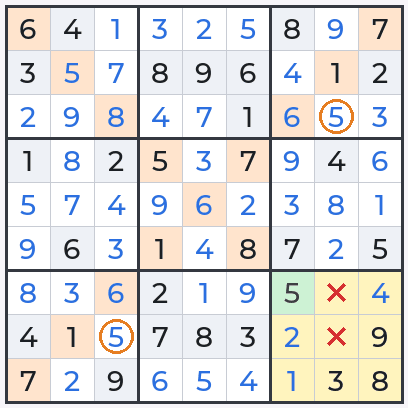

#### Step 48: the 6 in box 9

Box 9 needs a 6. r7c8: row 7 has one (r7c3). Only **r8c8** is left: **r8c8 = 6**.

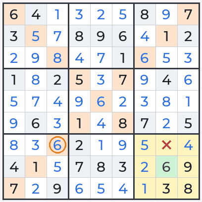

#### Step 49: the 7 in box 9

Box 9 needs a 7, and r7c8 is its last empty cell: **r7c8 = 7**.

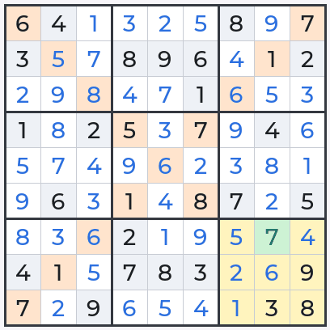

Solved.

<!-- /walkthrough -->
