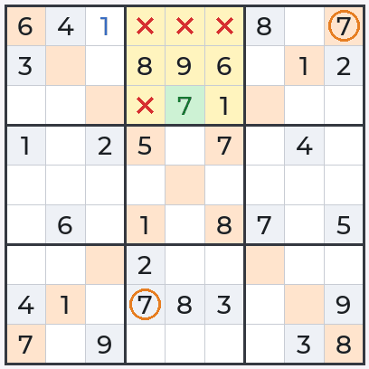

<!-- Written by tools/walkthrough.py anti-diagonal: edit the script, not this page. -->
# Anti-Diagonal, step 2: the 7 in box 2

**Step 2 of 49** · [← Step 1](step-01.md) · [All steps](../anti-diagonal.md#the-whole-puzzle-step-by-step) · [Step 3 →](step-03.md)

Box 2 needs a 7. r1c4, r1c5 and r1c6: row 1 has one (r1c9). r3c4: column 4 has one (r8c4). Only **r3c5** is left: **r3c5 = 7**.

**Step 2 of 49** · [← Step 1](step-01.md) · [All steps](../anti-diagonal.md#the-whole-puzzle-step-by-step) · [Step 3 →](step-03.md)
