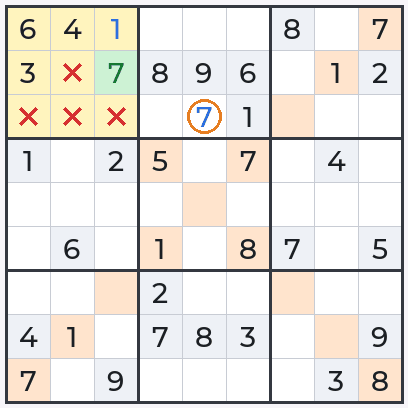

<!-- Written by tools/walkthrough.py anti-diagonal: edit the script, not this page. -->
# Anti-Diagonal, step 3: the 7 in box 1

**Step 3 of 49** · [← Step 2](step-02.md) · [All steps](../anti-diagonal.md#the-whole-puzzle-step-by-step) · [Step 4 →](step-04.md)

Box 1 needs a 7. r3c1, r3c2 and r3c3: row 3 has one (r3c5). r2c2: its long diagonal holds 5, 6 and 8 already, three different digits at most. Only **r2c3** is left: **r2c3 = 7**.

**Step 3 of 49** · [← Step 2](step-02.md) · [All steps](../anti-diagonal.md#the-whole-puzzle-step-by-step) · [Step 4 →](step-04.md)
