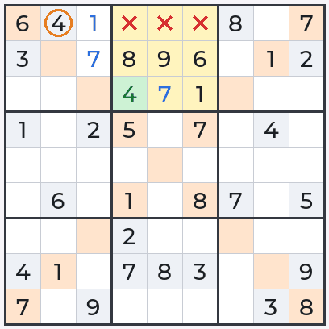

<!-- Written by tools/walkthrough.py anti-diagonal: edit the script, not this page. -->
# Anti-Diagonal, step 4: the 4 in box 2

**Step 4 of 49** · [← Step 3](step-03.md) · [All steps](../anti-diagonal.md#the-whole-puzzle-step-by-step) · [Step 5 →](step-05.md)

Box 2 needs a 4. r1c4, r1c5 and r1c6: row 1 has one (r1c2). Only **r3c4** is left: **r3c4 = 4**.

**Step 4 of 49** · [← Step 3](step-03.md) · [All steps](../anti-diagonal.md#the-whole-puzzle-step-by-step) · [Step 5 →](step-05.md)
