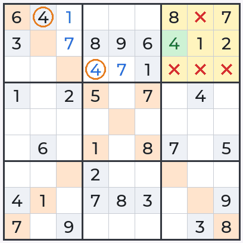

<!-- Written by tools/walkthrough.py anti-diagonal: edit the script, not this page. -->
# Anti-Diagonal, step 5: the 4 in box 3

**Step 5 of 49** · [← Step 4](step-04.md) · [All steps](../anti-diagonal.md#the-whole-puzzle-step-by-step) · [Step 6 →](step-06.md)

Box 3 needs a 4. r1c8: row 1 has one (r1c2). r3c7, r3c8 and r3c9: row 3 has one (r3c4). Only **r2c7** is left: **r2c7 = 4**.

**Step 5 of 49** · [← Step 4](step-04.md) · [All steps](../anti-diagonal.md#the-whole-puzzle-step-by-step) · [Step 6 →](step-06.md)
