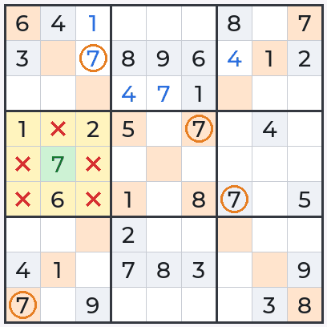

<!-- Written by tools/walkthrough.py anti-diagonal: edit the script, not this page. -->
# Anti-Diagonal, step 6: the 7 in box 4

**Step 6 of 49** · [← Step 5](step-05.md) · [All steps](../anti-diagonal.md#the-whole-puzzle-step-by-step) · [Step 7 →](step-07.md)

Box 4 needs a 7. r4c2: row 4 has one (r4c6). r5c1: column 1 has one (r9c1). r5c3: column 3 has one (r2c3). r6c1 and r6c3: row 6 has one (r6c7). Only **r5c2** is left: **r5c2 = 7**.

**Step 6 of 49** · [← Step 5](step-05.md) · [All steps](../anti-diagonal.md#the-whole-puzzle-step-by-step) · [Step 7 →](step-07.md)
