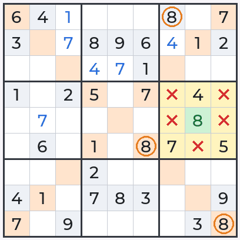

<!-- Written by tools/walkthrough.py anti-diagonal: edit the script, not this page. -->
# Anti-Diagonal, step 7: the 8 in box 6

**Step 7 of 49** · [← Step 6](step-06.md) · [All steps](../anti-diagonal.md#the-whole-puzzle-step-by-step) · [Step 8 →](step-08.md)

Box 6 needs an 8. r4c7 and r5c7: column 7 has one (r1c7). r4c9 and r5c9: column 9 has one (r9c9). r6c8: row 6 has one (r6c6). Only **r5c8** is left: **r5c8 = 8**.

**Step 7 of 49** · [← Step 6](step-06.md) · [All steps](../anti-diagonal.md#the-whole-puzzle-step-by-step) · [Step 8 →](step-08.md)
