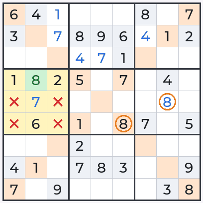

<!-- Written by tools/walkthrough.py anti-diagonal: edit the script, not this page. -->
# Anti-Diagonal, step 8: the 8 in box 4

**Step 8 of 49** · [← Step 7](step-07.md) · [All steps](../anti-diagonal.md#the-whole-puzzle-step-by-step) · [Step 9 →](step-09.md)

Box 4 needs an 8. r5c1 and r5c3: row 5 has one (r5c8). r6c1 and r6c3: row 6 has one (r6c6). Only **r4c2** is left: **r4c2 = 8**.

**Step 8 of 49** · [← Step 7](step-07.md) · [All steps](../anti-diagonal.md#the-whole-puzzle-step-by-step) · [Step 9 →](step-09.md)
