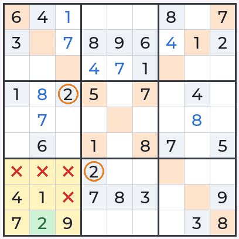

<!-- Written by tools/walkthrough.py anti-diagonal: edit the script, not this page. -->
# Anti-Diagonal, step 9: the 2 in box 7

**Step 9 of 49** · [← Step 8](step-08.md) · [All steps](../anti-diagonal.md#the-whole-puzzle-step-by-step) · [Step 10 →](step-10.md)

Box 7 needs a 2. r7c1, r7c2 and r7c3: row 7 has one (r7c4). r8c3: column 3 has one (r4c3). Only **r9c2** is left: **r9c2 = 2**.

**Step 9 of 49** · [← Step 8](step-08.md) · [All steps](../anti-diagonal.md#the-whole-puzzle-step-by-step) · [Step 10 →](step-10.md)
