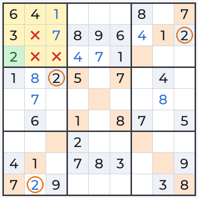

<!-- Written by tools/walkthrough.py anti-diagonal: edit the script, not this page. -->
# Anti-Diagonal, step 10: the 2 in box 1

**Step 10 of 49** · [← Step 9](step-09.md) · [All steps](../anti-diagonal.md#the-whole-puzzle-step-by-step) · [Step 11 →](step-11.md)

Box 1 needs a 2. r2c2: row 2 has one (r2c9). r3c2: column 2 has one (r9c2). r3c3: column 3 has one (r4c3). Only **r3c1** is left: **r3c1 = 2**.

**Step 10 of 49** · [← Step 9](step-09.md) · [All steps](../anti-diagonal.md#the-whole-puzzle-step-by-step) · [Step 11 →](step-11.md)
