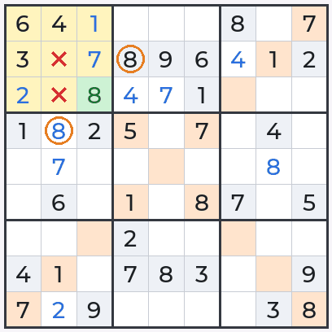

<!-- Written by tools/walkthrough.py anti-diagonal: edit the script, not this page. -->
# Anti-Diagonal, step 11: the 8 in box 1

**Step 11 of 49** · [← Step 10](step-10.md) · [All steps](../anti-diagonal.md#the-whole-puzzle-step-by-step) · [Step 12 →](step-12.md)

Box 1 needs an 8. r2c2: row 2 has one (r2c4). r3c2: column 2 has one (r4c2). Only **r3c3** is left: **r3c3 = 8**.

**Step 11 of 49** · [← Step 10](step-10.md) · [All steps](../anti-diagonal.md#the-whole-puzzle-step-by-step) · [Step 12 →](step-12.md)
