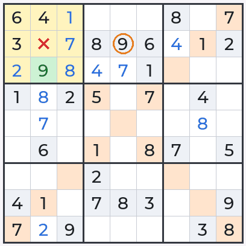

<!-- Written by tools/walkthrough.py anti-diagonal: edit the script, not this page. -->
# Anti-Diagonal, step 12: the 9 in box 1

**Step 12 of 49** · [← Step 11](step-11.md) · [All steps](../anti-diagonal.md#the-whole-puzzle-step-by-step) · [Step 13 →](step-13.md)

Box 1 needs a 9. r2c2: row 2 has one (r2c5). Only **r3c2** is left: **r3c2 = 9**.

**Step 12 of 49** · [← Step 11](step-11.md) · [All steps](../anti-diagonal.md#the-whole-puzzle-step-by-step) · [Step 13 →](step-13.md)
