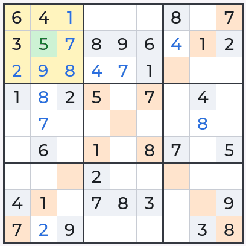

<!-- Written by tools/walkthrough.py anti-diagonal: edit the script, not this page. -->
# Anti-Diagonal, step 13: the 5 in box 1

**Step 13 of 49** · [← Step 12](step-12.md) · [All steps](../anti-diagonal.md#the-whole-puzzle-step-by-step) · [Step 14 →](step-14.md)

Box 1 needs a 5, and r2c2 is its last empty cell: **r2c2 = 5**.

**Step 13 of 49** · [← Step 12](step-12.md) · [All steps](../anti-diagonal.md#the-whole-puzzle-step-by-step) · [Step 14 →](step-14.md)
