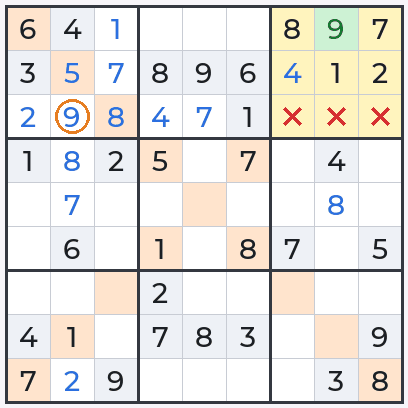

<!-- Written by tools/walkthrough.py anti-diagonal: edit the script, not this page. -->
# Anti-Diagonal, step 14: the 9 in box 3

**Step 14 of 49** · [← Step 13](step-13.md) · [All steps](../anti-diagonal.md#the-whole-puzzle-step-by-step) · [Step 15 →](step-15.md)

Box 3 needs a 9. r3c7, r3c8 and r3c9: row 3 has one (r3c2). Only **r1c8** is left: **r1c8 = 9**.

**Step 14 of 49** · [← Step 13](step-13.md) · [All steps](../anti-diagonal.md#the-whole-puzzle-step-by-step) · [Step 15 →](step-15.md)
