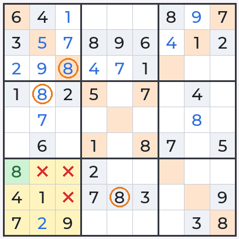

<!-- Written by tools/walkthrough.py anti-diagonal: edit the script, not this page. -->
# Anti-Diagonal, step 15: the 8 in box 7

**Step 15 of 49** · [← Step 14](step-14.md) · [All steps](../anti-diagonal.md#the-whole-puzzle-step-by-step) · [Step 16 →](step-16.md)

Box 7 needs an 8. r7c2: column 2 has one (r4c2). r7c3: column 3 has one (r3c3). r8c3: row 8 has one (r8c5). Only **r7c1** is left: **r7c1 = 8**.

**Step 15 of 49** · [← Step 14](step-14.md) · [All steps](../anti-diagonal.md#the-whole-puzzle-step-by-step) · [Step 16 →](step-16.md)
