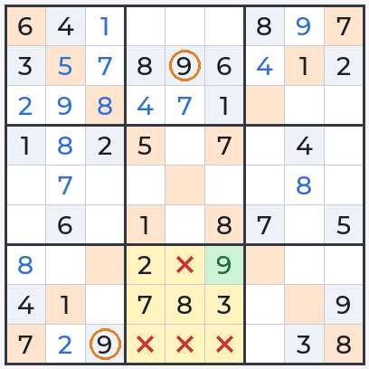

<!-- Written by tools/walkthrough.py anti-diagonal: edit the script, not this page. -->
# Anti-Diagonal, step 16: the 9 in box 8

**Step 16 of 49** · [← Step 15](step-15.md) · [All steps](../anti-diagonal.md#the-whole-puzzle-step-by-step) · [Step 17 →](step-17.md)

Box 8 needs a 9. r7c5: column 5 has one (r2c5). r9c4, r9c5 and r9c6: row 9 has one (r9c3). Only **r7c6** is left: **r7c6 = 9**.

**Step 16 of 49** · [← Step 15](step-15.md) · [All steps](../anti-diagonal.md#the-whole-puzzle-step-by-step) · [Step 17 →](step-17.md)
