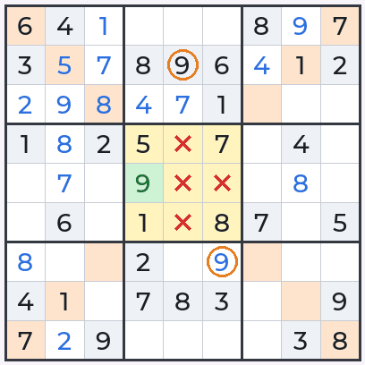

<!-- Written by tools/walkthrough.py anti-diagonal: edit the script, not this page. -->
# Anti-Diagonal, step 17: the 9 in box 5

**Step 17 of 49** · [← Step 16](step-16.md) · [All steps](../anti-diagonal.md#the-whole-puzzle-step-by-step) · [Step 18 →](step-18.md)

Box 5 needs a 9. r4c5, r5c5 and r6c5: column 5 has one (r2c5). r5c6: column 6 has one (r7c6). Only **r5c4** is left: **r5c4 = 9**.

**Step 17 of 49** · [← Step 16](step-16.md) · [All steps](../anti-diagonal.md#the-whole-puzzle-step-by-step) · [Step 18 →](step-18.md)
