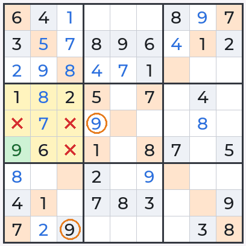

<!-- Written by tools/walkthrough.py anti-diagonal: edit the script, not this page. -->
# Anti-Diagonal, step 18: the 9 in box 4

**Step 18 of 49** · [← Step 17](step-17.md) · [All steps](../anti-diagonal.md#the-whole-puzzle-step-by-step) · [Step 19 →](step-19.md)

Box 4 needs a 9. r5c1 and r5c3: row 5 has one (r5c4). r6c3: column 3 has one (r9c3). Only **r6c1** is left: **r6c1 = 9**.

**Step 18 of 49** · [← Step 17](step-17.md) · [All steps](../anti-diagonal.md#the-whole-puzzle-step-by-step) · [Step 19 →](step-19.md)
