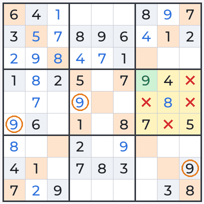

<!-- Written by tools/walkthrough.py anti-diagonal: edit the script, not this page. -->
# Anti-Diagonal, step 19: the 9 in box 6

**Step 19 of 49** · [← Step 18](step-18.md) · [All steps](../anti-diagonal.md#the-whole-puzzle-step-by-step) · [Step 20 →](step-20.md)

Box 6 needs a 9. r4c9: column 9 has one (r8c9). r5c7 and r5c9: row 5 has one (r5c4). r6c8: row 6 has one (r6c1). Only **r4c7** is left: **r4c7 = 9**.

**Step 19 of 49** · [← Step 18](step-18.md) · [All steps](../anti-diagonal.md#the-whole-puzzle-step-by-step) · [Step 20 →](step-20.md)
