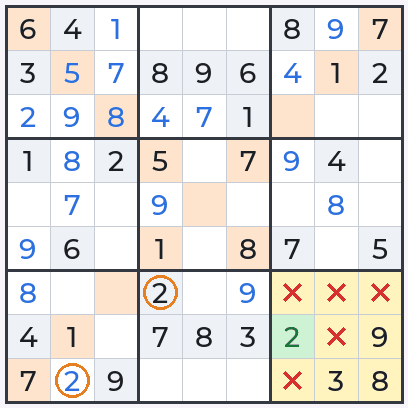

<!-- Written by tools/walkthrough.py anti-diagonal: edit the script, not this page. -->
# Anti-Diagonal, step 20: the 2 in box 9

**Step 20 of 49** · [← Step 19](step-19.md) · [All steps](../anti-diagonal.md#the-whole-puzzle-step-by-step) · [Step 21 →](step-21.md)

Box 9 needs a 2. r7c7, r7c8 and r7c9: row 7 has one (r7c4). r9c7: row 9 has one (r9c2). r8c8: its long diagonal holds 5, 6 and 8 already, three different digits at most. Only **r8c7** is left: **r8c7 = 2**.

**Step 20 of 49** · [← Step 19](step-19.md) · [All steps](../anti-diagonal.md#the-whole-puzzle-step-by-step) · [Step 21 →](step-21.md)
