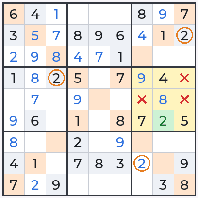

<!-- Written by tools/walkthrough.py anti-diagonal: edit the script, not this page. -->
# Anti-Diagonal, step 21: the 2 in box 6

**Step 21 of 49** · [← Step 20](step-20.md) · [All steps](../anti-diagonal.md#the-whole-puzzle-step-by-step) · [Step 22 →](step-22.md)

Box 6 needs a 2. r4c9: row 4 has one (r4c3). r5c7: column 7 has one (r8c7). r5c9: column 9 has one (r2c9). Only **r6c8** is left: **r6c8 = 2**.

**Step 21 of 49** · [← Step 20](step-20.md) · [All steps](../anti-diagonal.md#the-whole-puzzle-step-by-step) · [Step 22 →](step-22.md)
