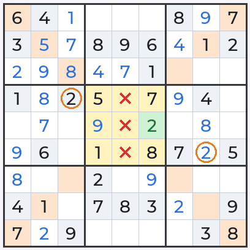

<!-- Written by tools/walkthrough.py anti-diagonal: edit the script, not this page. -->
# Anti-Diagonal, step 22: the 2 in box 5

**Step 22 of 49** · [← Step 21](step-21.md) · [All steps](../anti-diagonal.md#the-whole-puzzle-step-by-step) · [Step 23 →](step-23.md)

Box 5 needs a 2. r4c5: row 4 has one (r4c3). r6c5: row 6 has one (r6c8). r5c5: its long diagonal holds 5, 6 and 8 already, three different digits at most. Only **r5c6** is left: **r5c6 = 2**.

**Step 22 of 49** · [← Step 21](step-21.md) · [All steps](../anti-diagonal.md#the-whole-puzzle-step-by-step) · [Step 23 →](step-23.md)
