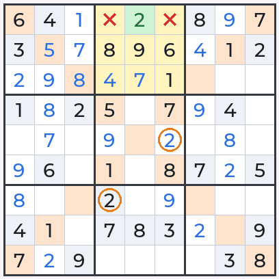

<!-- Written by tools/walkthrough.py anti-diagonal: edit the script, not this page. -->
# Anti-Diagonal, step 23: the 2 in box 2

**Step 23 of 49** · [← Step 22](step-22.md) · [All steps](../anti-diagonal.md#the-whole-puzzle-step-by-step) · [Step 24 →](step-24.md)

Box 2 needs a 2. r1c4: column 4 has one (r7c4). r1c6: column 6 has one (r5c6). Only **r1c5** is left: **r1c5 = 2**.

**Step 23 of 49** · [← Step 22](step-22.md) · [All steps](../anti-diagonal.md#the-whole-puzzle-step-by-step) · [Step 24 →](step-24.md)
