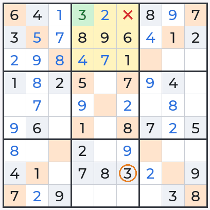

<!-- Written by tools/walkthrough.py anti-diagonal: edit the script, not this page. -->
# Anti-Diagonal, step 24: the 3 in box 2

**Step 24 of 49** · [← Step 23](step-23.md) · [All steps](../anti-diagonal.md#the-whole-puzzle-step-by-step) · [Step 25 →](step-25.md)

Box 2 needs a 3. r1c6: column 6 has one (r8c6). Only **r1c4** is left: **r1c4 = 3**.

**Step 24 of 49** · [← Step 23](step-23.md) · [All steps](../anti-diagonal.md#the-whole-puzzle-step-by-step) · [Step 25 →](step-25.md)
