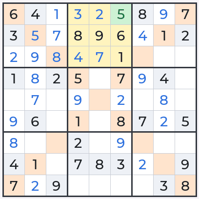

<!-- Written by tools/walkthrough.py anti-diagonal: edit the script, not this page. -->
# Anti-Diagonal, step 25: the 5 in box 2

**Step 25 of 49** · [← Step 24](step-24.md) · [All steps](../anti-diagonal.md#the-whole-puzzle-step-by-step) · [Step 26 →](step-26.md)

Box 2 needs a 5, and r1c6 is its last empty cell: **r1c6 = 5**.

**Step 25 of 49** · [← Step 24](step-24.md) · [All steps](../anti-diagonal.md#the-whole-puzzle-step-by-step) · [Step 26 →](step-26.md)
