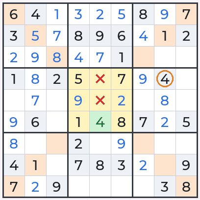

<!-- Written by tools/walkthrough.py anti-diagonal: edit the script, not this page. -->
# Anti-Diagonal, step 26: the 4 in box 5

**Step 26 of 49** · [← Step 25](step-25.md) · [All steps](../anti-diagonal.md#the-whole-puzzle-step-by-step) · [Step 27 →](step-27.md)

Box 5 needs a 4. r4c5: row 4 has one (r4c8). r5c5: its long diagonal holds 5, 6 and 8 already, three different digits at most. Only **r6c5** is left: **r6c5 = 4**.

**Step 26 of 49** · [← Step 25](step-25.md) · [All steps](../anti-diagonal.md#the-whole-puzzle-step-by-step) · [Step 27 →](step-27.md)
