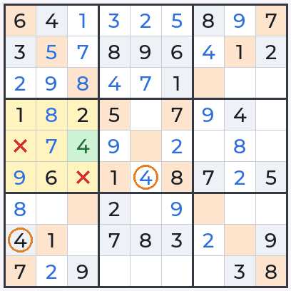

<!-- Written by tools/walkthrough.py anti-diagonal: edit the script, not this page. -->
# Anti-Diagonal, step 27: the 4 in box 4

**Step 27 of 49** · [← Step 26](step-26.md) · [All steps](../anti-diagonal.md#the-whole-puzzle-step-by-step) · [Step 28 →](step-28.md)

Box 4 needs a 4. r5c1: column 1 has one (r8c1). r6c3: row 6 has one (r6c5). Only **r5c3** is left: **r5c3 = 4**.

**Step 27 of 49** · [← Step 26](step-26.md) · [All steps](../anti-diagonal.md#the-whole-puzzle-step-by-step) · [Step 28 →](step-28.md)
