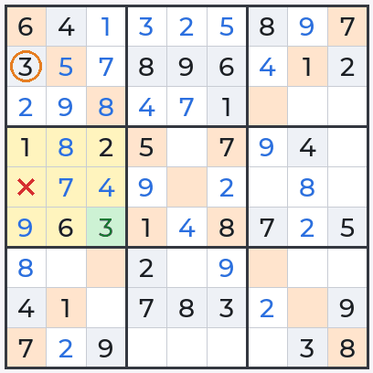

<!-- Written by tools/walkthrough.py anti-diagonal: edit the script, not this page. -->
# Anti-Diagonal, step 28: the 3 in box 4

**Step 28 of 49** · [← Step 27](step-27.md) · [All steps](../anti-diagonal.md#the-whole-puzzle-step-by-step) · [Step 29 →](step-29.md)

Box 4 needs a 3. r5c1: column 1 has one (r2c1). Only **r6c3** is left: **r6c3 = 3**.

**Step 28 of 49** · [← Step 27](step-27.md) · [All steps](../anti-diagonal.md#the-whole-puzzle-step-by-step) · [Step 29 →](step-29.md)
