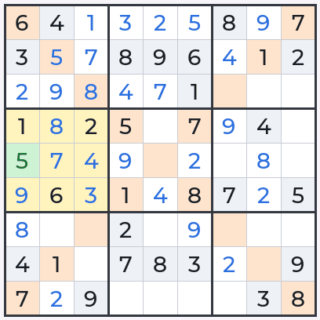

<!-- Written by tools/walkthrough.py anti-diagonal: edit the script, not this page. -->
# Anti-Diagonal, step 29: the 5 in box 4

**Step 29 of 49** · [← Step 28](step-28.md) · [All steps](../anti-diagonal.md#the-whole-puzzle-step-by-step) · [Step 30 →](step-30.md)

Box 4 needs a 5, and r5c1 is its last empty cell: **r5c1 = 5**.

**Step 29 of 49** · [← Step 28](step-28.md) · [All steps](../anti-diagonal.md#the-whole-puzzle-step-by-step) · [Step 30 →](step-30.md)
