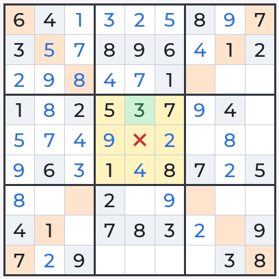

<!-- Written by tools/walkthrough.py anti-diagonal: edit the script, not this page. -->
# Anti-Diagonal, step 30: the 3 in box 5

**Step 30 of 49** · [← Step 29](step-29.md) · [All steps](../anti-diagonal.md#the-whole-puzzle-step-by-step) · [Step 31 →](step-31.md)

Box 5 needs a 3. r5c5: its long diagonal holds 5, 6 and 8 already, three different digits at most. Only **r4c5** is left: **r4c5 = 3**.

**Step 30 of 49** · [← Step 29](step-29.md) · [All steps](../anti-diagonal.md#the-whole-puzzle-step-by-step) · [Step 31 →](step-31.md)
