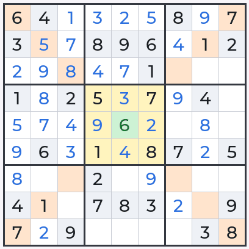

<!-- Written by tools/walkthrough.py anti-diagonal: edit the script, not this page. -->
# Anti-Diagonal, step 31: the 6 in box 5

**Step 31 of 49** · [← Step 30](step-30.md) · [All steps](../anti-diagonal.md#the-whole-puzzle-step-by-step) · [Step 32 →](step-32.md)

Box 5 needs a 6, and r5c5 is its last empty cell: **r5c5 = 6**.

**Step 31 of 49** · [← Step 30](step-30.md) · [All steps](../anti-diagonal.md#the-whole-puzzle-step-by-step) · [Step 32 →](step-32.md)
