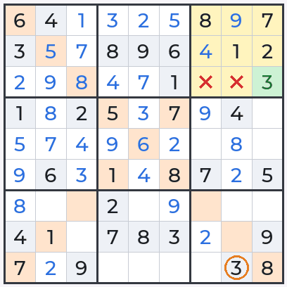

<!-- Written by tools/walkthrough.py anti-diagonal: edit the script, not this page. -->
# Anti-Diagonal, step 32: the 3 in box 3

**Step 32 of 49** · [← Step 31](step-31.md) · [All steps](../anti-diagonal.md#the-whole-puzzle-step-by-step) · [Step 33 →](step-33.md)

Box 3 needs a 3. r3c8: column 8 has one (r9c8). r3c7: its long diagonal holds 1, 6 and 7 already, three different digits at most. Only **r3c9** is left: **r3c9 = 3**.

**Step 32 of 49** · [← Step 31](step-31.md) · [All steps](../anti-diagonal.md#the-whole-puzzle-step-by-step) · [Step 33 →](step-33.md)
