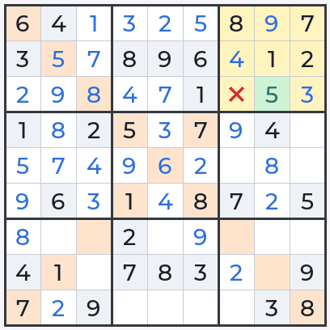

<!-- Written by tools/walkthrough.py anti-diagonal: edit the script, not this page. -->
# Anti-Diagonal, step 33: the 5 in box 3

**Step 33 of 49** · [← Step 32](step-32.md) · [All steps](../anti-diagonal.md#the-whole-puzzle-step-by-step) · [Step 34 →](step-34.md)

Box 3 needs a 5. r3c7: its long diagonal holds 1, 6 and 7 already, three different digits at most. Only **r3c8** is left: **r3c8 = 5**.

**Step 33 of 49** · [← Step 32](step-32.md) · [All steps](../anti-diagonal.md#the-whole-puzzle-step-by-step) · [Step 34 →](step-34.md)
