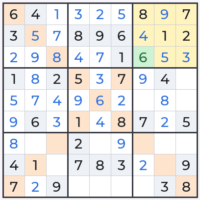

<!-- Written by tools/walkthrough.py anti-diagonal: edit the script, not this page. -->
# Anti-Diagonal, step 34: the 6 in box 3

**Step 34 of 49** · [← Step 33](step-33.md) · [All steps](../anti-diagonal.md#the-whole-puzzle-step-by-step) · [Step 35 →](step-35.md)

Box 3 needs a 6, and r3c7 is its last empty cell: **r3c7 = 6**.

**Step 34 of 49** · [← Step 33](step-33.md) · [All steps](../anti-diagonal.md#the-whole-puzzle-step-by-step) · [Step 35 →](step-35.md)
