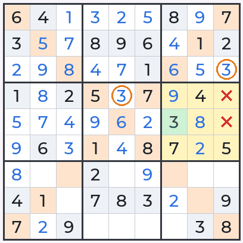

<!-- Written by tools/walkthrough.py anti-diagonal: edit the script, not this page. -->
# Anti-Diagonal, step 35: the 3 in box 6

**Step 35 of 49** · [← Step 34](step-34.md) · [All steps](../anti-diagonal.md#the-whole-puzzle-step-by-step) · [Step 36 →](step-36.md)

Box 6 needs a 3. r4c9: row 4 has one (r4c5). r5c9: column 9 has one (r3c9). Only **r5c7** is left: **r5c7 = 3**.

**Step 35 of 49** · [← Step 34](step-34.md) · [All steps](../anti-diagonal.md#the-whole-puzzle-step-by-step) · [Step 36 →](step-36.md)
