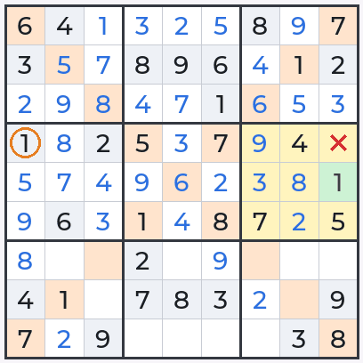

<!-- Written by tools/walkthrough.py anti-diagonal: edit the script, not this page. -->
# Anti-Diagonal, step 36: the 1 in box 6

**Step 36 of 49** · [← Step 35](step-35.md) · [All steps](../anti-diagonal.md#the-whole-puzzle-step-by-step) · [Step 37 →](step-37.md)

Box 6 needs a 1. r4c9: row 4 has one (r4c1). Only **r5c9** is left: **r5c9 = 1**.

**Step 36 of 49** · [← Step 35](step-35.md) · [All steps](../anti-diagonal.md#the-whole-puzzle-step-by-step) · [Step 37 →](step-37.md)
