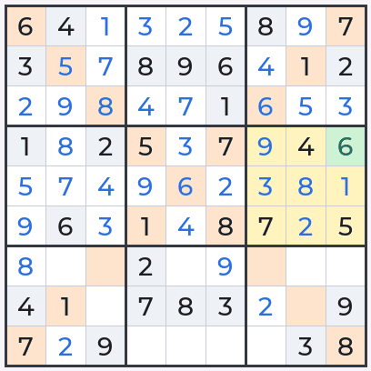

<!-- Written by tools/walkthrough.py anti-diagonal: edit the script, not this page. -->
# Anti-Diagonal, step 37: the 6 in box 6

**Step 37 of 49** · [← Step 36](step-36.md) · [All steps](../anti-diagonal.md#the-whole-puzzle-step-by-step) · [Step 38 →](step-38.md)

Box 6 needs a 6, and r4c9 is its last empty cell: **r4c9 = 6**.

**Step 37 of 49** · [← Step 36](step-36.md) · [All steps](../anti-diagonal.md#the-whole-puzzle-step-by-step) · [Step 38 →](step-38.md)
